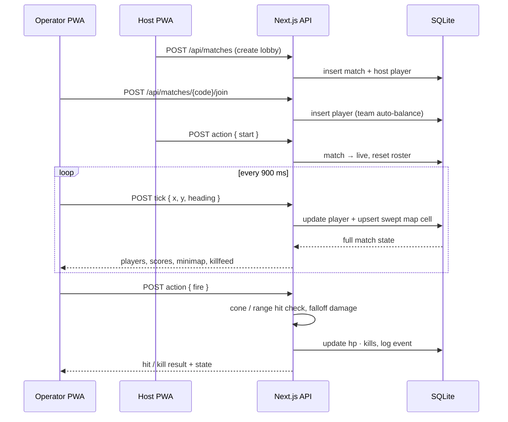
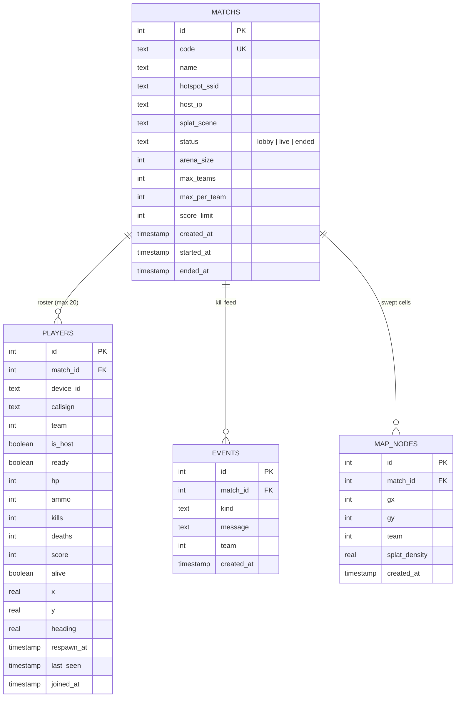

# NexusAR Strike

Room-scale first-person **AR combat** for Android, built as an installable PWA.
Up to **4 teams × 5 operators** play on one Wi-Fi hotspot — no internet required —
with Gaussian-splat scene enhancement and a progressive auto-tracking minimap.

## Features

- **LAN-only squad link** — the host opens an Android hotspot (`AR-STRIKE-LAN`);
  every operator joins the same SSID, so matchmaking, telemetry and hit
  registration all stay on the local network.
- **4 teams × 5 operators** (ALPHA / BRAVO / CHARLIE / DELTA), enforced server-side.
- **AR passthrough** — camera feed with a Gaussian-splat relighting overlay
  (4 pre-captured scenes), composited on a canvas.
- **Compass aiming** via device-orientation sensors, with drag-to-look fallback.
- **Real hit model** — 28 m fire range, 14° cone, distance falloff damage,
  30-round magazines, 6 s auto-redeploy.
- **Progressive auto-track minimap** — every 4 m cell an operator sweeps is
  persisted, so the fog-of-war map builds itself as squads advance.
- **Installable PWA** — manifest + service worker (app-shell precache,
  offline fallback, zero caching of game traffic).

## Architecture

```mermaid
flowchart TD
  subgraph LAN["Wi-Fi hotspot · AR-STRIKE-LAN (no internet needed)"]
    HOST["📱 Host phone<br/>PWA — opens the match"]
    OPS["📱 Operator phones<br/>PWA — join via 5-char code"]
  end

  subgraph SERVER["Next.js 16 server (runs on the host device)"]
    PAGES["App Router UI<br/>/ · /play/[code] · /install · /android"]
    API["REST API routes<br/>/api/matches<br/>/api/matches/[code]/join<br/>/api/matches/[code]/tick<br/>/api/matches/[code]/action<br/>/api/health"]
    ENGINE["Game engine<br/>lib/game.ts — spawn, hit check, respawn<br/>lib/state.ts — match state builder"]
    DB[("SQLite file<br/>nexus-ar-strike.db<br/>Drizzle ORM · WAL mode")]
  end

  HOST -->|host match · fire · start/end| API
  OPS -->|join · tick (pose) · fire/reload/ready| API
  PAGES -->|fetch| API
  API --> ENGINE
  ENGINE -->|reads / writes match state| DB
```

### Live match loop



## Persistence layer — SQLite

State is persisted to a **local SQLite file** (`nexus-ar-strike.db`, WAL mode)
through [Drizzle ORM](https://orm.drizzle.team/). A file database needs no
external server, which keeps the whole match self-contained on the host phone
over the hotspot. Migrations auto-apply at boot (`drizzle/` folder), so a fresh
checkout or a reinstalled host works with zero database setup.



## Project structure

```
src/
├── app/
│   ├── page.tsx                  # lobby — host a match or join by code
│   ├── play/[code]/page.tsx      # match shell
│   ├── install/page.tsx          # PWA install guide
│   ├── android/page.tsx          # field manual
│   └── api/
│       ├── health/route.ts
│       ├── matches/route.ts            # GET list · POST create
│       └── matches/[code]/
│           ├── join/route.ts           # link a device to a squad
│           ├── tick/route.ts           # pose updates + map sweep + auto-end
│           └── action/route.ts         # fire · reload · ready · start · end …
├── components/
│   ├── ARScene.tsx               # camera passthrough + splat overlay + contacts
│   ├── GameClient.tsx            # HUD, polling loop, movement integration
│   ├── Joystick.tsx              # virtual movement stick
│   ├── Minimap.tsx               # fog-of-war canvas, auto-track cells
│   └── InstallPrompt.tsx         # beforeinstallprompt handler
├── db/
│   ├── index.ts                  # better-sqlite3 client + auto-migrate
│   └── schema.ts                 # Drizzle table definitions
└── lib/
    ├── game.ts                   # rules & geometry constants
    ├── state.ts                  # match-state queries
    └── device.ts                 # device id / callsign (localStorage)
drizzle/                          # SQL migrations (applied on boot)
public/
├── manifest.webmanifest          # PWA manifest
└── sw.js                         # service worker (offline shell)
```

## Getting started

```bash
npm install
npm run dev        # → http://localhost:3000  (SQLite DB auto-created on first boot)
```

Production:

```bash
npm run build
npm run start
```

Schema changes:

```bash
npm run db:generate   # drizzle-kit generate → new SQL in drizzle/
npm run db:push       # push schema directly (no migration journal)
npm run db:studio     # browse the database
```

## Configuration

| Variable       | Default                | Purpose                              |
| -------------- | ---------------------- | ------------------------------------ |
| `SQLITE_FILE`  | `nexus-ar-strike.db`   | Path of the SQLite database file     |
| `PORT`         | `3000`                 | Dev server port                      |

## API reference

| Method | Route                          | Purpose                                        |
| ------ | ------------------------------ | ---------------------------------------------- |
| GET    | `/api/matches`                 | list active lobbies                            |
| POST   | `/api/matches`                 | host a match → `{ code }`                      |
| POST   | `/api/matches/{code}/join`     | join / re-link a device → `{ code, playerId }` |
| POST   | `/api/matches/{code}/tick`     | pose update → full match state                 |
| POST   | `/api/matches/{code}/action`   | `fire` `reload` `ready` `team` `start` `end` … |
| GET    | `/api/health`                  | DB liveness probe                              |

## Field setup

1. Host enables the Android hotspot; squads join the same SSID.
2. Open the host's LAN address (e.g. `http://192.168.43.1:3000`) on each phone.
3. Grant camera + motion-sensor permission for AR passthrough and compass heading.
4. Walk the arena — swept cells stream into the shared progressive minimap.
5. Install as an app: visit `/install` and use **Add to Home screen**.
